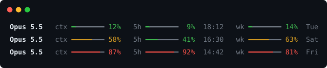

# claude-statusline

A status line for [Claude Code](https://claude.com/claude-code): how full your context window is, and how much of your plan's 5-hour and weekly limits you've used.



One file, no dependencies, nothing sent anywhere.

## Setup

**The easy way:** paste this into Claude Code and let it do the rest.

> Set up the status line from https://github.com/andreas-purse/claude-statusline for me.

Then start a new session.

**By hand:** needs Node 18+.

```sh
git clone https://github.com/andreas-purse/claude-statusline.git ~/claude-statusline
```

Add this to `~/.claude/settings.json`, then start a new session:

```json
{
  "statusLine": {
    "type": "command",
    "command": "node ~/claude-statusline/statusline.js",
    "padding": 0
  }
}
```

On Windows, use the full path: `"node C:/Users/you/claude-statusline/statusline.js"`. To update, `git pull` in the folder.

## Reading it

- `ctx`: context window used
- `5h`: 5-hour limit used, and the time it resets
- `wk`: weekly limit used, and the day it resets

Green under 50%, yellow from 50%, red from 80%. The limit meters appear after Claude's first reply in a session, on Pro and Max plans only.

## Not showing?

In the cloned folder, run:

```sh
echo '{"model":{"display_name":"Opus"}}' | node statusline.js
```

If it prints `Opus   ctx ━━━━━━━━  0%`, the script works and the path in `settings.json` is wrong.

## License

MIT
